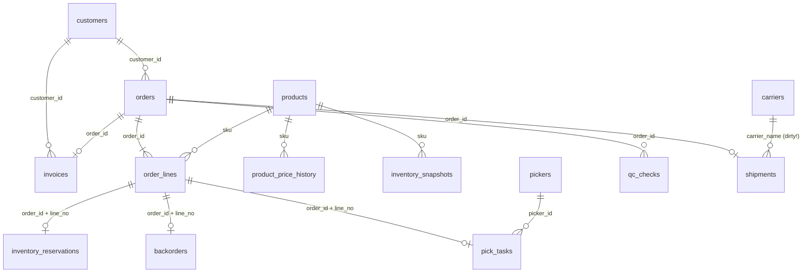

# Data Dictionary – BA raw dataset

Generated by `generate_data.py` (see [README.md](README.md)).

- **Period:** orders received 2025-11-01 to 2026-10-31.
- **Extract moment:** 2026-11-01 00:00. Events after this moment do not exist yet.
- **Format:** CSV (UTF-8, comma separated, `.` as decimal separator) plus `raw/ba_raw.sqlite`.
- **Timestamps:** `YYYY-MM-DD HH:MM:SS`, local time (Europe/Berlin).
- **Dates:** `YYYY-MM-DD`.
- **Empty value:** an empty CSV field is a NULL (SQL `NULL`).

Approximate row counts are for the default seed (42).

---

## 1. Source systems and tables

| Source system | Table | Grain (one row per …) | Rows | Business key |
|---|---|---|---|---|
| ERP – master | `customers` | customer (current state) | 400 | `customer_id` |
| ERP – master | `products` | SKU (current state) | 80 | `sku` |
| ERP – master | `product_price_history` | SKU × price validity period | 112 | `sku` + `valid_from` |
| HR / WMS – master | `pickers` | warehouse picker | 10 | `picker_id` |
| TMS – master | `carriers` | carrier contract | 4 | `carrier_code` |
| API / ERP | `orders` | order **message** (may contain duplicates!) | ~25.3k | `order_id` (+ `api_message_id`) |
| API / ERP | `order_lines` | order line | ~62k | `order_id` + `line_no` |
| ERP – inventory | `inventory_reservations` | reserved order line | ~55k | `reservation_id` |
| ERP – inventory | `backorders` | short order line of a backordered order | ~1.5k | `backorder_id` |
| ERP – inventory | `inventory_snapshots` | SKU × day (end-of-day) | 29.2k | `snapshot_date` + `sku` |
| WMS | `pick_tasks` | pick task (= one order line) | ~55k | `pick_task_id` |
| WMS | `qc_checks` | pack/QC attempt | ~24k | `qc_check_id` |
| Carrier feed | `shipments` | shipment (= one order) | ~22.8k | `shipment_id` |
| Finance / ERP | `invoices` | invoice (= one order) | ~22.8k | `invoice_id` |
| Finance / GL | `handling_costs` | cost posting | ~1.3k | `cost_entry_id` |

## 2. Relationships

Notes:
- `shipments` reference carriers by **name**, not code, as the carrier feed delivers them. The names are not always clean, so you need a mapping to `carriers.carrier_code`.
- `pick_tasks.ordered_sku` and `pick_tasks.picked_sku` both reference `products.sku`.
- `handling_costs` has no order key. Allocate it by date and cost centre, for example to fulfilled orders per day or month.

---

## 3. Tables

### 3.1 `customers` (ERP customer master, current state)
| Column | Type | Description |
|---|---|---|
| customer_id | text | Business key, `C00001`… |
| customer_name | text | Company name |
| segment | text | `Key Account`, `Wholesale`, `Retail`, `SME` |
| country_code | text | `DE`, `NL`, `AT`, `FR`, `BE` |
| city | text | City. **Sometimes NULL** (data-quality issue) |
| credit_limit_eur | decimal | Credit limit |
| credit_status | text | **Current** status: `GOOD`, `WATCH`, `HOLD`. It may differ from the status when an order was placed (see `orders.credit_status_at_order`). |
| created_at | timestamp | Customer onboarded. About 12 % are onboarded during the data period. |
| last_modified_at | timestamp | Last master-data change |

### 3.2 `products` (ERP product master, current state)
| Column | Type | Description |
|---|---|---|
| sku | text | Business key, `SKU-10001`… |
| product_name | text | Name. **Some have trailing spaces.** |
| category | text | `Electronics`, `Home & Kitchen`, `Office Supplies`, `Sports & Outdoor`, `Toys & Games` |
| list_price_eur | decimal | **Current** list price. For history, see `product_price_history`. |
| unit_cost_eur | decimal | Standard purchase cost |
| weight_kg | decimal | Unit weight |
| storage_bay | text | `Zone-Aisle-Level`, for example `A-07-3`. The zone is the category. |
| is_active | text | `Y`/`N` |
| created_at | timestamp | Record creation |

### 3.3 `product_price_history` (ERP price list, SCD-2 style)
| Column | Type | Description |
|---|---|---|
| sku | text | → `products.sku` |
| list_price_eur | decimal | Price valid in the period |
| valid_from | date | Start of validity (inclusive) |
| valid_to | date | End of validity (inclusive). NULL means the price is current. |

### 3.4 `pickers` (HR/WMS staff master)
| Column | Type | Description |
|---|---|---|
| picker_id | text | `PK001`… |
| picker_name | text | Fictional name |
| shift | text | `EARLY` (06–14) or `LATE` (14–22), Mon–Sat |
| employment_type | text | `Permanent` or `Temporary` (seasonal) |
| hire_date | date | Start of employment |
| termination_date | date | End of employment. NULL means still employed. |

### 3.5 `carriers` (carrier contracts)
| Column | Type | Description |
|---|---|---|
| carrier_code | text | `SWP`, `EFR`, `PNW`, `TLX` |
| carrier_name | text | Official name |
| pickup_times_weekday | text | Scheduled pickups Mon–Fri, comma separated |
| pickup_times_saturday | text | Saturday pickups (NULL = none) |
| contracted_transit_days | int | Domestic transit in business days (+1 for international) |
| base_rate_eur | decimal | Rate per package |
| rate_per_kg_eur | decimal | Rate per kg |

### 3.6 `orders` (API/ERP order header)
| Column | Type | Description |
|---|---|---|
| order_id | text | `SO0000001`… **Not unique:** about 0.4 % of orders were sent twice by the API. |
| api_message_id | text | Unique per API message |
| customer_id | text | → `customers` |
| channel | text | `EDI`, `WEB`, `MARKETPLACE`, `MOBILE_APP`. **Inconsistent casing and whitespace** in about 3 % of rows. |
| priority | text | `STANDARD` / `EXPRESS` |
| received_ts | timestamp | Order received by the API (**start of the cycle**) |
| ingested_ts | timestamp | Written to the ERP. For duplicates, minutes later. |
| validated_ts | timestamp | Validation finished. NULL if still pending at extract. |
| validation_result | text | `PASSED` / `FAILED` |
| validation_reason | text | If failed: `CREDIT_HOLD`, `INVALID_ADDRESS`, `MISSING_PO_NUMBER`, `CREDIT_LIMIT_EXCEEDED`, `PRICE_MISMATCH` |
| credit_status_at_order | text | Customer credit status when the order was placed |
| customer_notified_ts | timestamp | Rejection notice sent to the customer |
| promised_ship_by_ts | timestamp | ERP dispatch promise. Orders received before 14:00 on a weekday must ship the same day by 19:00; later orders by 19:00 on the next business day. |
| order_status | text | Status at extract: `RECEIVED`, `REJECTED`, `BACKORDERED`, `IN_FULFILMENT`, `SHIPPED`, `DELIVERED` |

### 3.7 `order_lines` (ERP order lines)
| Column | Type | Description |
|---|---|---|
| order_id | text | → `orders` |
| line_no | int | 1… |
| sku | text | → `products` |
| ordered_qty | int | Units ordered |
| unit_price_eur | decimal | List price **at order time** |
| discount_pct | decimal | Segment discount in % (Key 12, Wholesale 8, Retail 4, SME 0) |

Line net value = `ordered_qty × unit_price_eur × (1 − discount_pct/100)`.

### 3.8 `inventory_reservations` (ERP stock allocation)
Exists only for orders that passed validation **and** had stock for every line.
| Column | Type | Description |
|---|---|---|
| reservation_id | text | `RS…` |
| order_id, line_no | | → `order_lines` |
| sku | text | → `products` |
| available_qty_before | int | Available-to-promise quantity just before the reservation |
| reserved_qty | int | Quantity reserved (= ordered) |
| reservation_ts | timestamp | Reservation time |

### 3.9 `backorders` (ERP backorder notices)
If **any** line of an order was short, the whole order is backordered and the process ends, as in the BPMN. Only the short lines are listed.
| Column | Type | Description |
|---|---|---|
| backorder_id | text | `BO…` |
| order_id, line_no | | → `order_lines` |
| sku | text | → `products` |
| ordered_qty | int | Units ordered |
| available_qty | int | Units available at check time |
| backorder_qty | int | Shortfall (`ordered − available`) |
| backorder_reason | text | `OUT_OF_STOCK` (available = 0) or `INSUFFICIENT_STOCK` |
| expected_restock_date | date | Next replenishment arrival if one is on order (else NULL) |
| backorder_ts | timestamp | Backorder created |
| notice_sent_ts | timestamp | Backorder notice sent to the customer |

### 3.10 `inventory_snapshots` (ERP end-of-day stock, periodic snapshot)
| Column | Type | Description |
|---|---|---|
| snapshot_date | date | Day (end of day) |
| sku | text | → `products` |
| on_hand_qty | int | Physical stock (`available + reserved`) |
| reserved_qty | int | Reserved but not yet picked |
| available_qty | int | Free to promise |
| on_order_qty | int | Open replenishment quantity |
| reorder_point | int | Reorder threshold |
| stockout_flag | text | `Y` if available = 0 or any backorder for the SKU that day, else `N` |

### 3.11 `pick_tasks` (WMS)
One task per reserved order line. Pick errors are **not** flagged here; compare ordered and picked values.
| Column | Type | Description |
|---|---|---|
| pick_task_id | text | `PT…` |
| order_id, line_no | | → `order_lines` |
| queue_name | text | `STANDARD`, `EXPRESS`, `BULK` (≥ 40 units) |
| picker_id | text | → `pickers`. NULL while `QUEUED`. |
| released_ts | timestamp | Released to the queue (15-minute waves, warehouse hours only) |
| assigned_ts | timestamp | Picker took the order. **Queue wait** = `assigned_ts − released_ts`. |
| pick_start_ts / pick_end_ts | timestamp | Line picked (lines of one order are picked in sequence) |
| storage_bay | text | Bay picked from |
| ordered_sku / picked_sku | text | Different values mean a **wrong item** was picked |
| ordered_qty / picked_qty | int | Different values mean a **short or over pick** |
| task_status | text | `QUEUED`, `IN_PROGRESS`, `COMPLETED` |

### 3.12 `qc_checks` (WMS pack & quality control)
One row per attempt. A FAIL is followed by rework and a new attempt.
| Column | Type | Description |
|---|---|---|
| qc_check_id | text | `QC…` |
| order_id | text | → `orders` |
| attempt_no | int | 1 = first check, 2+ = re-check after rework |
| pack_station | text | `PACK-01`, `PACK-02` |
| qc_start_ts / qc_end_ts | timestamp | Pack and check duration |
| qc_result | text | `PASS` / `FAIL` |
| defect_type | text | `WRONG_ITEM`, `QTY_SHORT`, `QTY_OVER`, `PACKAGING_DAMAGE`, `LABEL_MISMATCH` |
| rework_minutes | decimal | Correction time after a FAIL |

### 3.13 `shipments` (carrier / tracking feed)
| Column | Type | Description |
|---|---|---|
| shipment_id | text | `SH…` |
| order_id | text | → `orders` |
| carrier_name | text | Carrier name. **Dirty:** varying casing and spaces. Map it to `carriers`. |
| service_level | text | `STANDARD` / `EXPRESS` |
| tracking_number | text | Carrier tracking number |
| label_created_ts | timestamp | Label printed |
| handoff_ts | timestamp | Parcel handed to the carrier at a scheduled pickup (**end of the cycle**). NULL means waiting for pickup. |
| promised_delivery_date | date | Promised to the customer: business days from the promise date (Standard 2 / Express 1, +1 international) |
| delivered_ts | timestamp | Delivered. NULL if in transit or exception. |
| delivery_status | text | `LABEL_CREATED`, `IN_TRANSIT`, `DELIVERED`, `EXCEPTION` (lost or damaged) |
| package_count | int | Parcels |
| weight_kg | decimal | Shipment weight |
| shipping_cost_eur | decimal | Freight cost |

### 3.14 `invoices` (finance)
| Column | Type | Description |
|---|---|---|
| invoice_id | text | `INV2025-000001`, numbered per year |
| order_id | text | → `orders` |
| customer_id | text | → `customers` |
| invoice_ts | timestamp | Invoice issued (usually minutes after handoff, sometimes days later) |
| net_amount_eur | decimal | Net amount |
| vat_rate | decimal | 0.19 for DE customers, 0.00 for EU reverse charge |
| vat_amount_eur / gross_amount_eur | decimal | VAT and gross amounts |
| currency | text | `EUR` |
| posting_status | text | `POSTED`, `PENDING` (waiting for the nightly batch), `ERROR` (posting failed) |
| ledger_posted_ts | timestamp | Posted to the general ledger (nightly batch at about 23:30) |

### 3.15 `handling_costs` (general-ledger cost postings)
| Column | Type | Description |
|---|---|---|
| cost_entry_id | text | `CE…` |
| posting_date | date | Posting date |
| cost_center | text | `PICKING`, `PACKING_QC`, `DISPATCH`, `WAREHOUSE` |
| cost_type | text | `LABOUR`, `PACKAGING_MATERIAL`, `FREIGHT`, `RENT`, `UTILITIES` |
| amount_eur | decimal | Amount |
| description | text | Free text |

Labour and materials are posted daily; rent and utilities monthly, on the 1st.

---

## 4. Known data-quality issues (intentional)

| # | Table.column | Issue | Suggested handling |
|---|---|---|---|
| 1 | `orders` | About 0.4 % duplicate `order_id` rows (API re-send, new `api_message_id`, later `ingested_ts`) | Keep the earliest `ingested_ts` per `order_id` |
| 2 | `orders.channel` | Mixed casing and trailing spaces (`web`, `Edi`, `WEB `) | `TRIM` + `UPPER` |
| 3 | `shipments.carrier_name` | Mixed casing and leading/trailing spaces | `TRIM` + `UPPER`, then map to `carriers.carrier_code` |
| 4 | `customers.city` | About 2 % NULL | Replace with "Unknown" |
| 5 | `products.product_name` | Trailing spaces | `TRIM` |
| 6 | `invoices` | `ERROR` / `PENDING` postings with NULL `ledger_posted_ts` | Keep; they measure billing completion |
| 7 | Many tables | NULLs for events after the extract moment (open orders, queued tasks, in transit) | Keep; they are the open pipeline |

Rates are configurable in `generate_data.py` (`DIRTY` dictionary). Set `INJECT_DIRTY_DATA = False` for clean data.

---

## 5. KPI definitions (from the process documentation)

| KPI | Formula on this data |
|---|---|
| Order-to-handoff time | `shipments.handoff_ts − orders.received_ts` (after de-duplicating orders) |
| On-time delivery rate | delivered shipments with `DATE(delivered_ts) ≤ promised_delivery_date` ÷ deliveries due |
| Picking accuracy | Σ correct units ÷ Σ picked units. Correct units = `MIN(picked_qty, ordered_qty)` if `picked_sku = ordered_sku`, else 0 (completed tasks only). |
| Backorder rate | orders with status `BACKORDERED` ÷ orders received |
| Validation hold / failure | `validated_ts − received_ts`; `validation_result = 'FAILED'` ÷ orders |
| QC failure / rework rate | attempt-1 `FAIL` ÷ attempt-1 checks; Σ `rework_minutes` |
| Cost per fulfilled order | Σ `handling_costs.amount_eur` (optionally excluding `FREIGHT`) ÷ orders with a `handoff_ts` in the period |
| Open order queue / age | orders with status `RECEIVED` or `IN_FULFILMENT`; `EXTRACT_TS − received_ts` |
| Picking queue / workload | `pick_tasks` by `picker_id` / `queue_name`; queue wait `assigned_ts − released_ts` |
| Approaching dispatch deadline | open orders where `promised_ship_by_ts` is close to or before "now" |
| Warehouse vs transit delay | `handoff_ts − received_ts` vs `delivered_ts − handoff_ts` |
| Billing completion | invoices `POSTED` ÷ shipped orders; `ledger_posted_ts − invoice_ts` |

---

## 6. Modelling hints

The data has candidate **facts** at several grains:

- order line (sales and fulfilment)
- pick task
- QC attempt
- shipment
- invoice
- daily inventory snapshot (a periodic snapshot)
- an accumulating snapshot of the order lifecycle
- cost postings

Candidate **dimensions**: date, time, customer, product, picker, carrier, channel, status and junk dimensions.

Watch for **SCD** candidates (customer credit status, product price) and **role-playing dates** (received, handoff, delivered, invoice).
