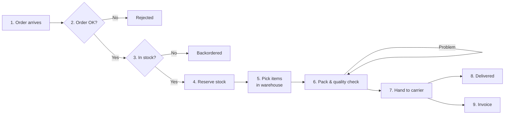
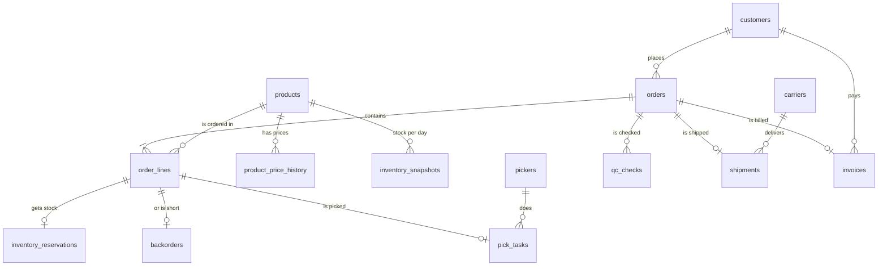
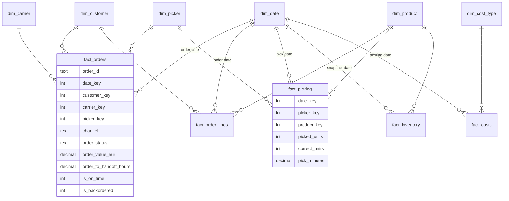

# BA Dataset – Simple Guide

This guide explains:

1. **What data we have**: the tables the Python script creates.
2. **How the tables connect**: a diagram (ERD).
3. **How to turn it into a star schema** for Power BI.

---

## 0. A few words first

| Word | Simple meaning |
|---|---|
| **Table** | A list of records, like one Excel sheet |
| **Column** | One piece of information in a table, e.g. "order date" |
| **Row** | One record, e.g. one order |
| **Primary key (PK)** | The column that identifies each row, like an ID card number |
| **Foreign key (FK)** | A column that points to a row in another table, e.g. an order points to its customer |
| **ERD** | A picture showing the tables and how they connect |
| **Fact table** | Stores *events and numbers*: orders, quantities, costs, times |
| **Dimension table** | Stores *descriptions* used to filter and group: customer, product, date |
| **Star schema** | One fact table in the middle with dimension tables around it, shaped like a star ⭐ |

**Data types used below**

| Type | Meaning | Example |
|---|---|---|
| Text | Letters and numbers | `SO0000001` |
| Whole number | Number without decimals | `5` |
| Decimal | Number with decimals | `19.99` |
| Date | A day | `2026-03-15` |
| Date & time | A day plus a time | `2026-03-15 14:32:10` |

---

## 1. The story behind the data

A company receives orders online. Each order goes through these steps:



Every step writes data into a table. The script produced **15 tables** (CSV files in the `raw/` folder, plus a SQLite database), covering **one year** (Nov 2025 – Oct 2026) and about **25,000 orders**.

The tables come in two kinds:
- **Master data** (who and what): customers, products, pickers, carriers. These are small lists.
- **Activity data** (what happened): orders, picking, shipping, invoices. These are large lists.

---

## 2. The tables

### Master data (the "who" and "what")

#### `customers` – who buys from us (400 rows)
| Column | Type | Meaning |
|---|---|---|
| **customer_id** (PK) | Text | Customer ID, e.g. `C00012` |
| customer_name | Text | Company name |
| segment | Text | Customer type: Key Account, Wholesale, Retail, SME |
| country_code | Text | Country: DE, NL, AT, FR, BE |
| city | Text | City (sometimes empty ⚠️) |
| credit_limit_eur | Decimal | Maximum credit allowed |
| credit_status | Text | GOOD, WATCH or HOLD (today's value) |
| created_at | Date & time | When the customer was added |
| last_modified_at | Date & time | Last time the record changed |

#### `products` – what we sell (80 rows)
| Column | Type | Meaning |
|---|---|---|
| **sku** (PK) | Text | Product code, e.g. `SKU-10005` |
| product_name | Text | Product name (some have extra spaces ⚠️) |
| category | Text | Electronics, Home & Kitchen, Office Supplies, … |
| list_price_eur | Decimal | Current selling price |
| unit_cost_eur | Decimal | What one unit costs us |
| weight_kg | Decimal | Weight of one unit |
| storage_bay | Text | Where it sits in the warehouse, e.g. `A-07-3` |
| is_active | Text | Y / N |
| created_at | Date & time | When the product was added |

#### `product_price_history` – old and new prices (112 rows)
| Column | Type | Meaning |
|---|---|---|
| sku (FK → products) | Text | Which product |
| list_price_eur | Decimal | Price in that period |
| valid_from | Date | Price starts |
| valid_to | Date | Price ends (empty = still valid) |

#### `pickers` – warehouse workers (10 rows)
| Column | Type | Meaning |
|---|---|---|
| **picker_id** (PK) | Text | Worker ID, e.g. `PK003` |
| picker_name | Text | Name |
| shift | Text | EARLY (06–14) or LATE (14–22) |
| employment_type | Text | Permanent or Temporary |
| hire_date | Date | Start date |
| termination_date | Date | End date (empty = still working) |

#### `carriers` – delivery companies (4 rows)
| Column | Type | Meaning |
|---|---|---|
| **carrier_code** (PK) | Text | Short code, e.g. `SWP` |
| carrier_name | Text | Company name |
| pickup_times_weekday | Text | When the truck comes Mon–Fri |
| pickup_times_saturday | Text | When the truck comes on Saturday |
| contracted_transit_days | Whole number | Normal delivery days |
| base_rate_eur | Decimal | Price per package |
| rate_per_kg_eur | Decimal | Price per kg |

### Activity data (what happened)

#### `orders` – one row per order received (≈ 25,300 rows)
| Column | Type | Meaning |
|---|---|---|
| order_id | Text | Order number. ⚠️ A few orders appear **twice**. |
| **api_message_id** (PK) | Text | Unique ID of the received message |
| customer_id (FK → customers) | Text | Who ordered |
| channel | Text | EDI, WEB, MARKETPLACE, MOBILE_APP (spelling not always clean ⚠️) |
| priority | Text | STANDARD or EXPRESS |
| received_ts | Date & time | When the order arrived ⏱ **start of the clock** |
| ingested_ts | Date & time | When it was saved in the system |
| validated_ts | Date & time | When the order check finished |
| validation_result | Text | PASSED or FAILED |
| validation_reason | Text | Why it failed (if it failed) |
| credit_status_at_order | Text | Customer's credit status on the order day |
| customer_notified_ts | Date & time | When we told the customer about a rejection |
| promised_ship_by_ts | Date & time | Latest time we promised to ship |
| order_status | Text | REJECTED, BACKORDERED, IN_FULFILMENT, SHIPPED, DELIVERED, RECEIVED |

#### `order_lines` – the products inside each order (≈ 62,000 rows)
| Column | Type | Meaning |
|---|---|---|
| **order_id + line_no** (PK) | Text + Whole number | Order number + line number |
| sku (FK → products) | Text | Which product |
| ordered_qty | Whole number | How many units |
| unit_price_eur | Decimal | Price per unit on the order day |
| discount_pct | Decimal | Discount in % |

> Line value = `ordered_qty × unit_price_eur × (1 − discount_pct / 100)`

#### `inventory_reservations` – stock put aside for an order (≈ 55,000 rows)
| Column | Type | Meaning |
|---|---|---|
| **reservation_id** (PK) | Text | Reservation ID |
| order_id, line_no (FK → order_lines) | Text, Whole number | Which order line |
| sku (FK → products) | Text | Which product |
| available_qty_before | Whole number | Stock free before reserving |
| reserved_qty | Whole number | Units reserved |
| reservation_ts | Date & time | When it was reserved |

#### `backorders` – lines we could not supply (≈ 1,500 rows)
| Column | Type | Meaning |
|---|---|---|
| **backorder_id** (PK) | Text | Backorder ID |
| order_id, line_no (FK → order_lines) | Text, Whole number | Which order line |
| sku (FK → products) | Text | Which product |
| ordered_qty | Whole number | Units wanted |
| available_qty | Whole number | Units we had |
| backorder_qty | Whole number | Units missing |
| backorder_reason | Text | OUT_OF_STOCK or INSUFFICIENT_STOCK |
| expected_restock_date | Date | When new stock should arrive |
| backorder_ts | Date & time | When the backorder was created |
| notice_sent_ts | Date & time | When the customer was told |

#### `inventory_snapshots` – stock level at the end of every day (29,200 rows)
| Column | Type | Meaning |
|---|---|---|
| **snapshot_date + sku** (PK) | Date + Text | Day + product |
| on_hand_qty | Whole number | Units physically in the warehouse |
| reserved_qty | Whole number | Units promised to orders |
| available_qty | Whole number | Units still free to sell |
| on_order_qty | Whole number | Units ordered from the supplier |
| reorder_point | Whole number | Level at which we reorder |
| stockout_flag | Text | Y = we ran out that day |

#### `pick_tasks` – workers collecting items from shelves (≈ 55,000 rows)
| Column | Type | Meaning |
|---|---|---|
| **pick_task_id** (PK) | Text | Task ID |
| order_id, line_no (FK → order_lines) | Text, Whole number | Which order line |
| queue_name | Text | STANDARD, EXPRESS or BULK |
| picker_id (FK → pickers) | Text | Who picked it |
| released_ts | Date & time | Task ready in the queue |
| assigned_ts | Date & time | Worker started on the order |
| pick_start_ts / pick_end_ts | Date & time | Picking start and end |
| storage_bay | Text | Shelf location |
| ordered_sku / picked_sku | Text | Product wanted / product taken (different = **mistake**) |
| ordered_qty / picked_qty | Whole number | Units wanted / units taken (different = **mistake**) |
| task_status | Text | QUEUED, IN_PROGRESS, COMPLETED |

#### `qc_checks` – packing and quality checks (≈ 24,000 rows)
| Column | Type | Meaning |
|---|---|---|
| **qc_check_id** (PK) | Text | Check ID |
| order_id (FK → orders) | Text | Which order |
| attempt_no | Whole number | 1 = first check, 2+ = re-check after fixing |
| pack_station | Text | Packing desk |
| qc_start_ts / qc_end_ts | Date & time | Check start and end |
| qc_result | Text | PASS or FAIL |
| defect_type | Text | What was wrong (WRONG_ITEM, QTY_SHORT, …) |
| rework_minutes | Decimal | Time spent fixing |

#### `shipments` – handing the parcel to the carrier (≈ 22,800 rows)
| Column | Type | Meaning |
|---|---|---|
| **shipment_id** (PK) | Text | Shipment ID |
| order_id (FK → orders) | Text | Which order |
| carrier_name | Text | Carrier (spelling not always clean ⚠️; match it to `carriers`) |
| service_level | Text | STANDARD or EXPRESS |
| tracking_number | Text | Tracking code |
| label_created_ts | Date & time | Shipping label printed |
| handoff_ts | Date & time | Given to the carrier ⏱ **end of the clock** |
| promised_delivery_date | Date | Date promised to the customer |
| delivered_ts | Date & time | Delivered (empty = still on the way) |
| delivery_status | Text | DELIVERED, IN_TRANSIT, EXCEPTION, LABEL_CREATED |
| package_count | Whole number | Number of boxes |
| weight_kg | Decimal | Total weight |
| shipping_cost_eur | Decimal | Delivery cost |

#### `invoices` – bills sent to customers (≈ 22,800 rows)
| Column | Type | Meaning |
|---|---|---|
| **invoice_id** (PK) | Text | Invoice number |
| order_id (FK → orders) | Text | Which order |
| customer_id (FK → customers) | Text | Who pays |
| invoice_ts | Date & time | Invoice created |
| net_amount_eur | Decimal | Amount before tax |
| vat_rate | Decimal | Tax rate (0.19 or 0) |
| vat_amount_eur | Decimal | Tax amount |
| gross_amount_eur | Decimal | Amount including tax |
| currency | Text | EUR |
| posting_status | Text | POSTED, PENDING or ERROR (in accounting) |
| ledger_posted_ts | Date & time | When it was recorded in accounting |

#### `handling_costs` – warehouse costs (≈ 1,300 rows)
| Column | Type | Meaning |
|---|---|---|
| **cost_entry_id** (PK) | Text | Cost record ID |
| posting_date | Date | Day of the cost |
| cost_center | Text | PICKING, PACKING_QC, DISPATCH, WAREHOUSE |
| cost_type | Text | LABOUR, PACKAGING_MATERIAL, FREIGHT, RENT, UTILITIES |
| amount_eur | Decimal | Amount |
| description | Text | Short note |

### ⚠️ Things to clean first (on purpose, like real data)

| Problem | Where | Fix (in Power Query or SQL) |
|---|---|---|
| Same order appears twice | `orders` | Remove duplicates on `order_id`, keeping the first one |
| Mixed spelling (`web`, `Web `) | `orders.channel` | Trim spaces and make UPPERCASE |
| Mixed spelling of carrier | `shipments.carrier_name` | Trim, UPPERCASE, then match to `carriers` |
| Empty city | `customers.city` | Replace with "Unknown" |
| Extra spaces | `products.product_name` | Trim |
| Empty dates | many tables | Leave them: the step has not happened yet |

---

## 3. How the raw tables connect (ERD)

Read a line like this: *one customer has many orders*.



Symbols: `||` = exactly one, `o{` = zero or many, `|{` = one or many, `o|` = zero or one.

`handling_costs` has no link to orders. It connects to everything else **only through the date**.

---

## 4. Suggested star schema

### 4.1 The idea in one picture

```
                 dim_customer
                      |
   dim_carrier ---- FACT ---- dim_date
                      |
                 dim_product
```

- **Facts** hold the numbers: counts, quantities, money, hours.
- **Dimensions** hold the words you filter by: customer, product, date, carrier.
- In Power BI, each dimension connects to the facts with a **one-to-many** relationship.

### 4.2 Dimension tables (6)

| Dimension | One row per | Built from | Useful columns |
|---|---|---|---|
| **dim_date** | Day (2025-01-01 → 2026-12-31) | Created in Power BI or SQL | date, year, month, month name, week, weekday, is_weekend |
| **dim_customer** | Customer | `customers` | name, segment, country, city |
| **dim_product** | Product | `products` | name, category, price, cost |
| **dim_picker** | Picker | `pickers` | name, shift, employment type |
| **dim_carrier** | Carrier | `carriers` | name, transit days |
| **dim_cost_type** | Cost centre + cost type | `handling_costs` (distinct values) | cost_center, cost_type |

Small codes such as `channel`, `priority` and `order_status` can stay as normal columns in the fact table. That keeps the model simple.

### 4.3 Fact tables (5)

| Fact | One row per | Built from | Main numbers | Answers |
|---|---|---|---|---|
| ⭐ **fact_orders** (the main one) | Order | `orders` (no duplicates) + `shipments` + `invoices` + totals from `order_lines` and `qc_checks` | hours from order to handoff, on-time flag, backorder flag, order value, shipping cost, QC attempts | Cycle time, on-time delivery, backorder rate |
| **fact_order_lines** | Order line | `order_lines` + `backorders` | quantity, value, backordered quantity | What sells, which products run short |
| **fact_picking** | Pick task | `pick_tasks` | picked units, correct units, pick minutes | Picking accuracy, workload per picker |
| **fact_inventory** | Product per day | `inventory_snapshots` | available, reserved, stockout flag | Stock risk |
| **fact_costs** | Cost record | `handling_costs` | amount | Cost per fulfilled order |

**Columns to calculate when you build `fact_orders`:**

| New column | How to calculate |
|---|---|
| `order_to_handoff_hours` | (`handoff_ts` − `received_ts`) in hours |
| `is_on_time` | 1 if the delivery date ≤ `promised_delivery_date`, else 0 (empty if not delivered) |
| `is_backordered` | 1 if `order_status` = BACKORDERED |
| `order_value_eur` | Sum of the line values of the order |

**Column to calculate in `fact_picking`:**

| New column | How to calculate |
|---|---|
| `correct_units` | If `picked_sku` = `ordered_sku`: the smaller of `picked_qty` and `ordered_qty`. Otherwise 0. |

### 4.4 Star schema ERD



### 4.5 KPIs and where they come from

| KPI | Target | Fact | Formula |
|---|---|---|---|
| Order-to-handoff time | < 2 hours | fact_orders | Average of `order_to_handoff_hours` |
| On-time delivery | 98 % | fact_orders | Sum of `is_on_time` ÷ number of delivered orders |
| Picking accuracy | 99.5 % | fact_picking | Sum of `correct_units` ÷ sum of `picked_units` |
| Backorder rate | – | fact_orders | Sum of `is_backordered` ÷ number of orders |
| Cost per fulfilled order | – | fact_costs + fact_orders | Total cost ÷ number of shipped orders (per month) |

Simple DAX examples:

```DAX
Orders            = COUNTROWS ( fact_orders )
Avg Handoff Hours = AVERAGE ( fact_orders[order_to_handoff_hours] )
On-Time %         = DIVIDE ( SUM ( fact_orders[is_on_time] ), COUNT ( fact_orders[is_on_time] ) )
Backorder %       = DIVIDE ( SUM ( fact_orders[is_backordered] ), [Orders] )
Picking Accuracy  = DIVIDE ( SUM ( fact_picking[correct_units] ), SUM ( fact_picking[picked_units] ) )
```

### 4.6 Simple rules to follow

1. **Clean first, then model.** Fix the ⚠️ issues in section 2 before anything else.
2. **One row = one thing.** Decide what one row means in each fact and don't mix levels, e.g. orders and order lines in the same table.
3. **Always use a date table** (`dim_date`) and mark it as a date table in Power BI.
4. **Relationships go from dimension to fact** (one-to-many), with single direction.
5. **Never connect two fact tables directly.** They meet through shared dimensions such as date or product.
6. **Don't add up stock over days.** Stock is a level, not a flow; use the last day of the period.
7. **Check your numbers.** After building, these should match: about 25,200 orders, about 7.4 hours to handoff on average, about 95 % on time, about 5.8 % backorders.
