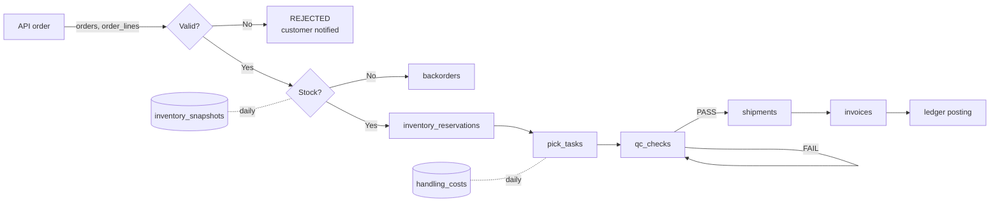

# BA – Order-to-Invoice Dummy Data Generator

`generate_data.py` creates a **raw, source-system-style** dataset for a fictional
distribution company. The data follows the BPMN process
(*order intake → validation → inventory → picking → QC → carrier handoff → invoice*).
It is intentionally **not** a star schema: you design and build the dimensional model
yourselves, for example in Power BI.

- What each table and column means: **[DATA_DICTIONARY.md](DATA_DICTIONARY.md)**
- How the script works: this README

---

## 1. Quick start

```bash
cd ~/Desktop/BA
python3 -m venv .venv                 # once
.venv/bin/pip install -r requirements.txt
.venv/bin/python generate_data.py
```

Output (around 25k orders, about 5 seconds to run):

```
raw/
├── customers.csv  products.csv  product_price_history.csv  pickers.csv  carriers.csv
├── orders.csv  order_lines.csv
├── inventory_reservations.csv  backorders.csv  inventory_snapshots.csv
├── pick_tasks.csv  qc_checks.csv
├── shipments.csv
├── invoices.csv  handling_costs.csv
└── ba_raw.sqlite          ← the same 15 tables in one SQLite database
```

The run prints integrity checks and the **baseline KPIs**. With the default seed:

| KPI | Baseline (generated) | Target (Step 1) |
|---|---|---|
| Order-to-handoff time | mean ≈ 7.4 h, median ≈ 3.8 h | < 2 h |
| On-time delivery | ≈ 95.3 % | 98 % |
| Picking accuracy (units) | ≈ 99.34 % | 99.5 % |
| Backorder rate | ≈ 5.8 % | – |
| Validation failure rate | ≈ 3.5 % | – |
| QC first-pass failure | ≈ 4.7 % | – |
| Cost per fulfilled order | ≈ €40.6 handling / ≈ €63.7 incl. freight | – |

The baseline deliberately misses the targets, so the dashboard has a gap to show.

---

## 2. Design principles

| Principle | How it is applied |
|---|---|
| **Raw, not modelled** | One table per source-system export (ERP, WMS, carrier feed, finance), with natural/business keys only. The data has no surrogate keys, no date table and no pre-computed KPIs. |
| **Process simulation, not random columns** | Every order follows the BPMN path. Rejected orders stop after validation and backordered orders stop after the stock check. Only reserved orders reach the WMS, carrier and invoice tables. |
| **Consistent timelines** | received ≤ validated ≤ reserved ≤ released ≤ assigned ≤ picked ≤ QC ≤ label ≤ handoff ≤ delivered / invoiced. `run_checks()` asserts this on every run. |
| **Realistic distributions** | Orders arrive as a Poisson process shaped by hour, weekday, month seasonality (Q4 peak) and growth. Durations are log-normal (right-skewed), and customer and product popularity are Pareto/Zipf-like. |
| **Real constraints create the KPIs** | Warehouse hours, picker shifts and absences, limited packing stations, fixed carrier pickup times and business-day delivery all shape the results. Cycle time comes out of these constraints; nothing sets it directly. |
| **Hidden root causes** | Some causes are in the data for the analysis to find (see section 5). |
| **Reproducible** | One random generator (`numpy.random.default_rng(SEED)`) drives everything, so the same seed always produces the same files. |
| **Configurable** | All parameters live in section 1 of the script. |
| **Light, controlled mess** | A few realistic data-quality issues are added at the very end, after the integrity checks. They can be switched off. |
| **Point-in-time extract** | The systems are "exported" at `EXTRACT_TS`. Anything later does not exist yet, so the data contains open orders, queued work, shipments in transit and pending postings. |

---

## 3. How the script works

The script runs top to bottom in 11 numbered sections:

| # | Section | What it does |
|---|---|---|
| 1 | Configuration | Every tunable parameter: dates, volumes, probabilities, rates, mess level. |
| 2 | Reference data | Countries, segments, product categories, pickers, carriers and their pickup schedules. |
| 3 | Helpers | Random helpers (`lognorm`, `choose`) and calendar logic (`next_open`, `next_office`, `add_business_days`, `ceil_to_wave`, `cut`). |
| 4 | Master data | `build_customers()` (including credit-status changes over time), `build_products()` (including a price change on 2026-04-01), `build_pickers()` (including absences and seasonal temps), `build_carriers()`. |
| 5 | Order intake | `generate_arrivals()` produces timestamps. `generate_orders()` assigns customers (only after their onboarding date), channels, priority and lines. `validate_orders()` applies the credit check, manual credit-desk review in office hours, rejections and the ERP dispatch promise. |
| 6 | Inventory | `simulate_inventory()` processes orders in validation order against a live stock position. If any line is short, the order is **backordered**; otherwise every line is **reserved**. A reorder-point policy places replenishments with supplier lead times, and the stock position is snapshotted at the end of each day. |
| 7 | Fulfilment | `simulate_fulfilment()`, a simple discrete-event simulation: <br>• WMS releases orders in **15-minute waves** during opening hours (Mon–Sat 06–22).<br>• The **first available picker** on shift takes the order. Line pick times depend on picker speed and quantity, and errors depend on the picker's error rate (higher after 20:00).<br>• **Pack & QC** runs on 2 stations. QC catches 92 % of pick errors and some packaging defects. A failure causes rework and a re-check (up to 3 attempts).<br>• The **label** is printed, then the order is handed to the **next scheduled pickup** of the chosen carrier.<br>• **Delivery** takes business days, plus a carrier-specific delay probability, plus 1 day for international orders.<br>• The **invoice** is raised shortly after handoff and posted to the ledger in a **nightly batch** (23:30). Some postings end in ERROR. |
| 8 | Cost records | `build_costs()` creates daily labour for present pickers and packers, packaging materials, a freight accrual, and monthly rent and utilities. |
| 9 | Assemble | `assemble()` turns the simulation into tables, generates IDs in event order, applies the extract cut-off and builds the daily inventory snapshot. |
| 10 | Checks / KPIs / mess / output | `run_checks()` → `print_kpis()` → `make_dirty()` → `write_outputs()` (CSV + SQLite). |
| 11 | `main()` | Runs the steps above in order. |

### Process flow → tables



---

## 4. Configuration cheat-sheet

| Parameter | Default | Effect |
|---|---|---|
| `SEED` | 42 | Change it for a different but statistically similar dataset. |
| `START_DATE` / `END_DATE` / `EXTRACT_TS` | 2025-11-01 → 2026-10-31, extract 2026-11-01 00:00 | Data period |
| `TARGET_ORDERS` | 25 000 | Expected order volume (actual count varies slightly) |
| `HOUR_WEIGHTS`, `WEEKDAY_WEIGHTS`, `MONTH_WEIGHTS`, `ANNUAL_GROWTH` | – | Demand pattern |
| `P_VALIDATION_FAIL`, `P_MANUAL_REVIEW` | per credit status | Validation outcome and delay |
| `SAFETY_FACTOR_RANGE`, `P_UNRELIABLE_SUPPLIER` | (1.1, 1.6), 15 % | Backorder rate |
| `PICKERS`, `PROBLEM_PICKER`, `N_PACK_STATIONS`, `SHIFTS` | 10 pickers, 2 stations | Capacity, queues, picking accuracy |
| `CARRIERS` (pickup times, `p_delay`, `transit`) | – | Cycle time and on-time delivery |
| `P_LEDGER_POST_ERROR`, `P_INVOICE_MANUAL_DELAY` | 1 %, 2 % | Billing completion |
| `INJECT_DIRTY_DATA`, `DIRTY` | True, light rates | Data-quality issues |

**To make the data cleaner or messier**, change the `DIRTY` rates, or set
`INJECT_DIRTY_DATA = False`.
**To move a KPI**, see section 5 for which parameter drives it, then check the printed KPIs.

---

## 5. Root causes built into the data

| Story | Where it shows up | Driven by |
|---|---|---|
| One picker (**PK008**) makes about 4× more errors than peers | `pick_tasks` (ordered vs picked), `qc_checks.defect_type` | `PROBLEM_PICKER` |
| Seasonal **temps** (PK009, PK010, Nov–mid Jan) are slower and less accurate | `pick_tasks`, `pickers.employment_type` | `PICKERS` |
| Errors rise in the late shift after 20:00 | `pick_tasks.pick_start_ts` | fatigue factor in `simulate_fulfilment` |
| **TransLogix** is cheap but delays more often; **EuroFreight** is slow (2-day transit) | `shipments` | `CARRIERS[...]["p_delay"]` |
| **Q4 peak** causes stockouts and backorders in December | `inventory_snapshots`, `backorders` | `MONTH_WEIGHTS`, fixed reorder points |
| Some SKUs have **unreliable suppliers** | repeated stockouts for the same SKUs | `P_UNRELIABLE_SUPPLIER` |
| **WATCH/HOLD customers** wait for a manual credit review in office hours | `orders.validated_ts – received_ts` | `P_MANUAL_REVIEW` |
| **Weekend and evening orders** wait for warehouse hours and carrier pickups | cycle time by weekday/hour | warehouse hours, pickup schedules |
| **International** orders take one more transit day and are invoiced at 0 % VAT | `shipments`, `invoices` | country logic |
| A **price increase** on 2026-04-01 (Electronics +4 %, Home & Kitchen +5 %) | `order_lines.unit_price_eur`, `product_price_history` | `PRICE_CHANGE` |
| Customer **credit status changes** during the year | `customers.credit_status` (current) vs `orders.credit_status_at_order` | `build_customers` |

The last two are good cases for **slowly changing dimensions** (SCD type 2).

---

## 6. Power BI tips

- **Get Data → Text/CSV** with *File origin = 65001: UTF-8*, or connect through ODBC to `ba_raw.sqlite`.
- Timestamps are `YYYY-MM-DD HH:MM:SS` and dates are `YYYY-MM-DD`. If Power BI misreads them, set the locale to *English (United States)* or use *Change type → Using locale*.
- Decimals use `.` and amounts are in EUR.
- Clean the known issues in Power Query: trim and uppercase `channel` and `carrier_name`, de-duplicate `orders` on `order_id` (keep the earliest `ingested_ts`), and handle the NULL `city`. See DATA_DICTIONARY.md §4.
- Build your own **Date** and **Time** dimensions. The many timestamps lend themselves to role-playing dates.

---

## 7. Extending the script

- **More volume:** raise `TARGET_ORDERS`, and scale `PICKERS` and `N_PACK_STATIONS` with it, or queues will explode.
- **New issue type:** add a rate to `DIRTY` and a few lines in `make_dirty()`.
- **New table:** build it in `assemble()` (or its own function), add it to the `order` list in `main()`, and document it in DATA_DICTIONARY.md.
- Keep any new randomness on the shared `rng` so the output stays reproducible.

## 8. Assumptions and limitations

- There is one warehouse, the currency is EUR, and the company is based in Germany with customers in DE, NL, AT, FR and BE.
- Backordered orders end the process, as in the BPMN; they are not fulfilled later.
- Pick errors that QC misses (about 8 %) ship to the customer. The data has no returns table.
- Invoices are based on ordered quantities and are one per order.
- Labour cost is wages for scheduled shifts, not productive time.
- Customers and products are fictional and generated from word lists. The person names are fictional too.
