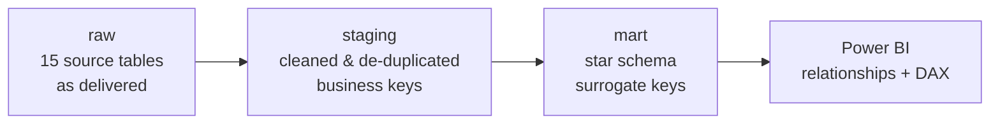

# Star Schema Recommendations – Order-to-Invoice Analytics

How to turn the raw dataset (`raw/`) into a dimensional model for the Power BI dashboard.

**Related documents:**
- [DATA_DICTIONARY.md](DATA_DICTIONARY.md) – what each column means
- [SCHEMA.md](SCHEMA.md) – the physical schema of the raw tables
- [modeling/examples.sql](modeling/examples.sql) – tested staging, dimension and fact SQL to start from

The approach follows Kimball's four steps:
1. Choose the **business process**.
2. Declare the **grain**.
3. Identify the **dimensions**.
4. Identify the **facts**.

---

## 1. Summary

| | Recommendation |
|---|---|
| **Business processes** | Order intake, inventory, picking, quality control, dispatch and invoicing, operating cost |
| **Fact tables (6)** | `fact_order_fulfilment` (accumulating snapshot) · `fact_order_line` · `fact_pick_task` · `fact_qc_check` · `fact_inventory_daily` (periodic snapshot) · `fact_handling_cost` |
| **Dimensions (9)** | `dim_date` (role-playing) · `dim_time` · `dim_customer` · `dim_product` · `dim_picker` · `dim_carrier` · `dim_order_profile` (junk) · `dim_qc_outcome` (junk) · `dim_cost_category` |
| **Main fact** | `fact_order_fulfilment`, one row per order with every milestone. It answers cycle time, on-time, backorder, QC rework and billing questions in one place. |
| **SCD strategy** | Type 1 everywhere. History that matters (credit status and price at order time) is captured **in the fact or junk dimension**. SCD type 2 is an optional extension (§6.3). |
| **Keys** | Integer surrogate keys; `date_key` = `yyyymmdd`; `-1` = unknown / not applicable |
| **Power BI** | Star relationships (1:*, single direction), one `dim_date` with active and inactive relationships, measures in DAX |

Keep it at this size. Every KPI in the process document maps to exactly one fact (§8), so no fact-to-fact joins are needed.

---

## 2. Layered architecture



| Layer | What happens | Where |
|---|---|---|
| **raw** | Untouched source extracts | `raw/*.csv` or `ba_raw.sqlite` |
| **staging** | Trim and upper-case codes, de-duplicate orders, map carrier names to codes, set data types, handle NULLs. **No business logic.** | SQL views (`stg_*`) **or** Power Query staging queries (disable load) |
| **mart** | Build dimensions with surrogate keys and facts at a declared grain, with derived measures (durations, flags) | SQL views/tables (`dim_*`, `fact_*`) **or** Power Query |
| **semantic** | Relationships, hierarchies, DAX measures, formatting | Power BI model |

**Recommendation:** build staging and mart as **SQL views on the SQLite file**, connect Power BI to the views (ODBC), or export them to CSV. SQL is easier to review, version and document than long Power Query scripts. Power Query alone also works; the logic is the same.

### 2.1 Staging rules (from the known raw-data issues)

| Raw table | Rule |
|---|---|
| `orders` | Keep the first message per `order_id` (`ROW_NUMBER() OVER (PARTITION BY order_id ORDER BY ingested_ts) = 1`) |
| `orders.channel` | `UPPER(TRIM(channel))` gives `EDI`, `WEB`, `MARKETPLACE`, `MOBILE_APP` |
| `shipments.carrier_name` | `UPPER(TRIM(...))` and join to `carriers` to get `carrier_code` |
| `customers.city` | NULL becomes `'Unknown'` |
| `products.product_name` | `TRIM` |
| all `_ts` / `_date` columns | Cast to datetime / date |
| open items (NULL `handoff_ts`, `delivered_ts`, …) | Keep NULL; they are the open pipeline, not errors |

`stg_orders` and `stg_shipments` are implemented in `modeling/examples.sql`.

---

## 3. Bus matrix

Rows are business processes (facts), columns are conformed dimensions. ● = used, ◐ = role-playing or optional.

| Fact \ Dimension | Date | Time | Customer | Product | Picker | Carrier | Order profile | QC outcome | Cost category |
|---|---|---|---|---|---|---|---|---|---|
| `fact_order_fulfilment` | ● ◐ (×7 roles) | ● | ● | | ● | ● | ● | | |
| `fact_order_line` | ● | | ● | ● | | | ● | | |
| `fact_pick_task` | ● | ● | | ● ◐ (ordered / picked) | ● | | | | |
| `fact_qc_check` | ● | ● | | | | | | ● | |
| `fact_inventory_daily` | ● | | | ● | | | | | |
| `fact_handling_cost` | ● | | | | | | | | ● |

`dim_date` is the **conformed** dimension that ties everything together. It is how cost (by posting date) and fulfilled orders (by handoff date) meet in *cost per fulfilled order*.

---

## 4. Star diagram

```mermaid
erDiagram
    dim_date ||--o{ fact_order_fulfilment : "received / handoff / delivered / promised / invoice ..."
    dim_time ||--o{ fact_order_fulfilment : "received_time_key"
    dim_customer ||--o{ fact_order_fulfilment : customer_key
    dim_carrier ||--o{ fact_order_fulfilment : carrier_key
    dim_picker ||--o{ fact_order_fulfilment : picker_key
    dim_order_profile ||--o{ fact_order_fulfilment : order_profile_key

    dim_date ||--o{ fact_order_line : received_date_key
    dim_customer ||--o{ fact_order_line : customer_key
    dim_product ||--o{ fact_order_line : product_key
    dim_order_profile ||--o{ fact_order_line : order_profile_key

    dim_date ||--o{ fact_pick_task : pick_date_key
    dim_time ||--o{ fact_pick_task : pick_time_key
    dim_picker ||--o{ fact_pick_task : picker_key
    dim_product ||--o{ fact_pick_task : product_key

    dim_date ||--o{ fact_qc_check : qc_date_key
    dim_qc_outcome ||--o{ fact_qc_check : qc_outcome_key

    dim_date ||--o{ fact_inventory_daily : snapshot_date_key
    dim_product ||--o{ fact_inventory_daily : product_key

    dim_date ||--o{ fact_handling_cost : posting_date_key
    dim_cost_category ||--o{ fact_handling_cost : cost_category_key
```



---

## 5. Dimensions

### 5.1 `dim_date` (conformed, role-playing)
| | |
|---|---|
| Grain | One row per calendar day, **2025-01-01 → 2026-12-31**. This covers every order, promise and delivery date. |
| Key | `date_key` INT `yyyymmdd` (e.g. 20251103) |
| Attributes | `date`, `year`, `quarter`, `month_no`, `month_name`, `year_month` (`2025-11`), `iso_week`, `day_of_week_no` (Mon = 1), `day_name`, `is_weekend`, `is_warehouse_day` (Mon–Sat), `is_business_day` (Mon–Fri), `season_flag` (e.g. `Peak` for Nov–Dec) |
| Source | Generated (SQL recursive CTE, Power Query `List.Dates`, or DAX `CALENDAR`) |
| Power BI | *Mark as date table*. Sort `month_name` by `month_no`. |

Role-playing use: received, validated, handoff, delivered, promised ship-by, promised delivery, invoice, ledger posting, pick, QC, snapshot and cost posting dates.

### 5.2 `dim_time`
| | |
|---|---|
| Grain | One row per **minute of day** (1,440 rows) |
| Key | `time_key` INT `hhmm` (e.g. 1435) |
| Attributes | `hour`, `minute`, `hour_label` (`14:00`), `day_part` (Night 22–06 / Morning / Afternoon / Evening), `shift` (`EARLY` 06–14, `LATE` 14–22, `CLOSED`), `is_before_cutoff` (< 14:00) |
| Why | Analysis by time of arrival (evening and weekend orders drive cycle time) and errors by shift or hour |

### 5.3 `dim_customer` — SCD type 1
| | |
|---|---|
| Grain | One row per customer, plus `-1 Unknown` |
| Key | `customer_key` (surrogate); `customer_id` (business key) |
| Attributes | `customer_name`, `segment`, `country_code`, `country_name`, `is_domestic` (DE), `city` (`Unknown` if NULL), `credit_limit_eur`, `credit_limit_band`, `current_credit_status`, `customer_since` (date), `is_new_customer` (onboarded during the period) |
| Source | `customers` |
| History | The credit status *at order time* is in `dim_order_profile`, so Type 1 is sufficient. See §6.3 for an optional SCD2. |

### 5.4 `dim_product` — SCD type 1
| | |
|---|---|
| Grain | One row per SKU, plus `-1 Unknown` |
| Key | `product_key`; `sku` |
| Attributes | `product_name` (trimmed), `product_family` (e.g. "Yoga Mat"), `variant`, `category`, `storage_zone` (first letter of bay), `storage_bay`, `current_list_price_eur`, `unit_cost_eur`, `price_band`, `weight_kg`, `is_active` |
| Source | `products` |
| Hierarchy | Category → Product family → SKU |
| History | The **transaction price** is stored in the fact (`unit_price_eur` from `order_lines`), so price changes need no SCD2. |

### 5.5 `dim_picker` — SCD type 1
| | |
|---|---|
| Grain | One row per picker, plus `-1 Unassigned` |
| Key | `picker_key`; `picker_id` |
| Attributes | `picker_name`, `shift`, `employment_type`, `hire_date`, `termination_date`, `is_active`, `tenure_band` (< 1 y, 1–3 y, > 3 y, measured at extract) |
| Source | `pickers` |

### 5.6 `dim_carrier` — SCD type 1
| | |
|---|---|
| Grain | One row per carrier, plus `-1 Not shipped` |
| Key | `carrier_key`; `carrier_code` |
| Attributes | `carrier_name`, `contracted_transit_days`, `base_rate_eur`, `rate_per_kg_eur`, `pickups_per_weekday` (count) |
| Source | `carriers`, joined to shipments via the cleaned name (`stg_shipments`) |

### 5.7 `dim_order_profile` — junk dimension
Combines the low-cardinality order flags into one small dimension instead of five tiny ones.

| | |
|---|---|
| Grain | One row per **distinct combination** of the attributes below (a few hundred rows at most) |
| Key | `order_profile_key` |
| Attributes | `channel` (cleaned), `priority`, `validation_result`, `validation_reason` (`N/A` if passed), `credit_status_at_order`, `order_status` |
| Source | `SELECT DISTINCT … FROM stg_orders` |
| Note | `order_status` changes over the life of an order. That is fine because the accumulating snapshot is **rebuilt on every load**. |

### 5.8 `dim_qc_outcome` — junk dimension
| | |
|---|---|
| Grain | One row per (`qc_result`, `defect_type`) combination |
| Attributes | `qc_result`, `defect_type` (`NONE` if pass), `defect_group` (`Picking error`: WRONG_ITEM / QTY_SHORT / QTY_OVER; `Packing error`: PACKAGING_DAMAGE / LABEL_MISMATCH) |

### 5.9 `dim_cost_category`
| | |
|---|---|
| Grain | One row per (`cost_center`, `cost_type`) |
| Attributes | `cost_center`, `cost_type`, `cost_behaviour` (Fixed: RENT, UTILITIES; Semi-variable: LABOUR; Variable: PACKAGING_MATERIAL, FREIGHT), `is_handling_cost` (all except FREIGHT) |

### Degenerate dimensions
These stay in the facts as plain columns (no dimension table): `order_id`, `line_no`, `pick_task_id`, `qc_check_id`, `shipment_id`, `tracking_number`, `invoice_id`, `queue_name`, `pack_station`, `attempt_no`.

---

## 6. Fact tables

### 6.1 `fact_order_fulfilment` — accumulating snapshot ⭐ main fact
| | |
|---|---|
| Grain | **One row per order** (de-duplicated), including rejected and backordered orders |
| Sources | `stg_orders` + aggregated `order_lines`, `pick_tasks`, `qc_checks` + `stg_shipments` + `invoices` |
| Dimension keys | `customer_key`, `order_profile_key`, `carrier_key` (-1 if not shipped), `picker_key` (-1 if not picked), `received_time_key` |
| Date keys (role-playing) | `received_date_key` (**active**), `handoff_date_key`, `delivered_date_key`, `promised_ship_by_date_key`, `promised_delivery_date_key`, `invoice_date_key`, `ledger_posted_date_key` (inactive in Power BI) |
| Milestone timestamps | `received_ts`, `validated_ts`, `released_ts`, `assigned_ts`, `pick_end_ts`, `qc_done_ts`, `handoff_ts`, `delivered_ts`, `invoice_ts`, `ledger_posted_ts` (hide in report view) |
| Additive measures | `line_count`, `units`, `net_value_eur`, `invoice_net_eur`, `invoice_gross_eur`, `shipping_cost_eur`, `qc_attempts`, `rework_minutes`, `pick_error_lines` |
| Lag measures (non-additive; average them) | `validation_h`, `queue_wait_min`, `pick_min`, `qc_min`, `wait_for_carrier_h`, **`order_to_handoff_h`**, `transit_h`, `invoice_lag_h` |
| Flags (0/1, sum or average) | `is_rejected`, `is_backordered`, `is_shipped`, `is_delivered`, `is_shipped_on_time` (handoff ≤ promised ship-by), **`is_on_time_delivery`**, `has_qc_fail`, `is_invoiced`, `is_ledger_posted` |
| Degenerate | `order_id`, `shipment_id`, `tracking_number`, `invoice_id` |

Why an accumulating snapshot? Every lag KPI (order-to-handoff, warehouse vs transit delay, billing lag) is the difference between two milestones **of the same order**. With one row per order holding every milestone, those are simple column subtractions, with no joins between facts in DAX. Shipment and invoice are 1:1 with the order, so they are folded in rather than given their own facts. Starter SQL: `fact_order_fulfilment_src` in `modeling/examples.sql`.

### 6.2 `fact_order_line` — transaction fact
| | |
|---|---|
| Grain | One row per order line |
| Sources | `order_lines` + `stg_orders` + `inventory_reservations` + `backorders` |
| Keys | `received_date_key`, `customer_key`, `product_key`, `order_profile_key`; degenerate `order_id`, `line_no` |
| Measures | `ordered_qty`, `gross_value_eur` (qty × unit price), `discount_eur`, `net_value_eur`, `cost_value_eur` (qty × `unit_cost_eur`), `reserved_qty`, `backorder_qty`, `is_backordered_line`, `unit_price_eur` (non-additive) |
| Answers | Demand by product, category and customer; backorder exposure by SKU; revenue and margin |

### 6.3 Optional: SCD type 2 for customer credit status
If you want to demonstrate SCD2, version `dim_customer` on `credit_status`:
- add `valid_from`, `valid_to` and `is_current`
- look up `customer_key` in the facts with `received_ts BETWEEN valid_from AND valid_to`

`dim_customer_credit_scd2` in `modeling/examples.sql` rebuilds the versions from the order history: 429 versions for 400 customers. The same pattern applies to `product_price_history` if you want "list price at order date".

### 6.4 `fact_pick_task` — transaction fact
| | |
|---|---|
| Grain | One row per pick task (= one reserved order line) |
| Source | `pick_tasks` |
| Keys | `pick_date_key`, `pick_time_key`, `picker_key`, `product_key` (ordered SKU), optional `picked_product_key` (role-playing); degenerate `order_id`, `pick_task_id`, `queue_name` |
| Measures | `ordered_units`, `picked_units`, **`correct_units`** (= MIN(picked, ordered) if picked SKU = ordered SKU, else 0), `is_error_line`, `error_type` (derived: WRONG_ITEM / QTY_SHORT / QTY_OVER / NONE), `pick_minutes`, `queue_wait_minutes` |
| Answers | Picking accuracy, picker workload and throughput, errors by picker, shift, hour and zone |

### 6.5 `fact_qc_check` — transaction fact
| | |
|---|---|
| Grain | One row per QC attempt |
| Source | `qc_checks` |
| Keys | `qc_date_key`, `qc_time_key`, `qc_outcome_key`; degenerate `order_id`, `attempt_no`, `pack_station` |
| Measures | `qc_minutes`, `rework_minutes`, `is_fail`, `is_first_attempt` |
| Answers | QC failure and rework rate, defect trends |

### 6.6 `fact_inventory_daily` — periodic snapshot
| | |
|---|---|
| Grain | One row per SKU per day |
| Source | `inventory_snapshots` |
| Keys | `snapshot_date_key`, `product_key` |
| Semi-additive measures | `on_hand_qty`, `reserved_qty`, `available_qty`, `on_order_qty`, `reorder_point`. Add across products, **never across days**; use the closing balance (§9). |
| Additive measures | `is_stockout` (0/1, sums to stockout SKU-days), `is_below_reorder_point` |
| Answers | Shortage risk, stockout trend, stock allocation |

### 6.7 `fact_handling_cost` — transaction fact
| | |
|---|---|
| Grain | One row per cost posting |
| Source | `handling_costs` |
| Keys | `posting_date_key`, `cost_category_key`; degenerate `cost_entry_id` |
| Measures | `amount_eur` |
| Answers | Cost per fulfilled order (with `fact_order_fulfilment` via `dim_date`), cost structure, labour vs volume |
| Note | Rent and utilities post on the 1st of the month, so report cost per order at **month** level or coarser. To report daily, allocate the monthly amounts over days in the mart. |

---

## 7. Design decisions and rationale

| Decision | Why |
|---|---|
| **One accumulating snapshot instead of separate order, shipment and invoice facts** | Order, shipment and invoice are 1:1. One row per order makes lag KPIs simple and avoids joining facts. |
| **Keep separate line, pick and QC facts** | They have different grains (line, task, attempt). Mixing grains in one table causes double counting. |
| **Junk dimensions for flags and codes** | They keep the facts narrow and give clean slicers without many tiny dimensions. |
| **History in the fact instead of SCD2** | Credit status and price at order time are already recorded on each transaction. That is simpler and fully accurate here. |
| **Surrogate keys and `-1` members** | They decouple the model from source IDs and make rejected or unshipped orders (no carrier, no picker) join cleanly. |
| **Integer `yyyymmdd` date keys** | They are readable, sort correctly and are standard practice. |
| **Pre-compute durations and flags in the mart** | DAX stays simple (AVERAGE, SUM, DIVIDE), and the business rules live in one documented place. |
| **Measure in hours (cycle) and minutes (warehouse steps)** | These match the targets: cycle time < 2 h, picking minutes. |
| **Open items kept** | NULL milestones represent work in progress and feed the lead indicators (open queue, order age, approaching deadlines). |

---

## 8. KPI → model mapping

| KPI (process document) | Fact | Calculation |
|---|---|---|
| Order-to-handoff time (target < 2 h) | `fact_order_fulfilment` | AVERAGE `order_to_handoff_h`; also show the median and P90 |
| On-time delivery rate (target 98 %) | `fact_order_fulfilment` | SUM `is_on_time_delivery` ÷ COUNT of delivered orders |
| Picking accuracy (target 99.5 %) | `fact_pick_task` | SUM `correct_units` ÷ SUM `picked_units` |
| Backorder rate | `fact_order_fulfilment` | SUM `is_backordered` ÷ orders |
| Cost per fulfilled order | `fact_handling_cost` + `fact_order_fulfilment` | SUM cost ÷ orders by **handoff date** (USERELATIONSHIP) |
| Open order queue and age | `fact_order_fulfilment` | Orders with `order_status` RECEIVED or IN_FULFILMENT; age = extract time − `received_ts` |
| Stockout / backorder exposure | `fact_inventory_daily`, `fact_order_line` | Stockout SKU-days; `backorder_qty` by SKU |
| Picking queue and workload | `fact_pick_task` | Tasks and units by picker, day and hour; `queue_wait_minutes` |
| QC failure and rework rate | `fact_qc_check` | First-attempt fails ÷ first attempts; SUM `rework_minutes` |
| Approaching dispatch deadlines | `fact_order_fulfilment` | Open orders with `promised_ship_by_ts` ≤ now + X h |
| Warehouse vs transit delay | `fact_order_fulfilment` | `order_to_handoff_h` vs `transit_h` |
| Billing completion | `fact_order_fulfilment` | SUM `is_ledger_posted` ÷ SUM `is_shipped` |

---

## 9. Power BI implementation

**Relationships**
- All are dimension (1) → fact (*), with **single** cross-filter direction. Avoid bi-directional filters.
- `dim_date` → `fact_order_fulfilment[received_date_key]` is **active**. The other date roles are **inactive**; activate them in measures with `USERELATIONSHIP`.
- If report users need to *slice* by handoff or delivery date, add a role-playing copy instead (`Handoff Date = dim_date` as a calculated table) with its own active relationship.
- Never relate fact to fact.

**Model hygiene**
- Hide surrogate keys and raw timestamps from report view.
- Put all measures in a dedicated `_Measures` table.
- Set formats (%, hours with 1 decimal, €) and sort-by columns (month name by month number).

**Starter DAX measures**

```DAX
Orders := COUNTROWS ( fact_order_fulfilment )

Avg Order-to-Handoff (h) := AVERAGE ( fact_order_fulfilment[order_to_handoff_h] )

Median Order-to-Handoff (h) := MEDIAN ( fact_order_fulfilment[order_to_handoff_h] )

On-Time Delivery % :=
DIVIDE (
    SUM ( fact_order_fulfilment[is_on_time_delivery] ),
    COUNT ( fact_order_fulfilment[is_on_time_delivery] )      -- COUNT skips blanks = not yet delivered
)

Backorder Rate % := DIVIDE ( SUM ( fact_order_fulfilment[is_backordered] ), [Orders] )

Picking Accuracy % :=
DIVIDE ( SUM ( fact_pick_task[correct_units] ), SUM ( fact_pick_task[picked_units] ) )

QC First-Pass Fail % :=
CALCULATE (
    DIVIDE ( SUM ( fact_qc_check[is_fail] ), COUNTROWS ( fact_qc_check ) ),
    fact_qc_check[attempt_no] = 1
)

Fulfilled Orders :=
CALCULATE (
    COUNTROWS ( fact_order_fulfilment ),
    USERELATIONSHIP ( fact_order_fulfilment[handoff_date_key], dim_date[date_key] ),
    NOT ISBLANK ( fact_order_fulfilment[handoff_date_key] )
)

Handling Cost := CALCULATE ( SUM ( fact_handling_cost[amount_eur] ), dim_cost_category[is_handling_cost] = TRUE () )

Cost per Fulfilled Order := DIVIDE ( [Handling Cost], [Fulfilled Orders] )

Closing Available Qty :=          -- semi-additive: last snapshot in the period
CALCULATE (
    SUM ( fact_inventory_daily[available_qty] ),
    LASTNONBLANK ( dim_date[date], CALCULATE ( COUNTROWS ( fact_inventory_daily ) ) )
)

Stockout SKU-Days := SUM ( fact_inventory_daily[is_stockout] )
```

For target lines, a small `kpi_target` table (KPI, target value) or constants such as `On-Time Target := 0.98` let you colour cards and add reference lines.

---

## 10. Build order checklist

1. ☐ Create staging views or queries (§2.1) and verify that `stg_orders` has one row per `order_id`.
2. ☐ Build `dim_date` and `dim_time`.
3. ☐ Build the master-data dimensions (customer, product, picker, carrier, cost category) with `-1` members.
4. ☐ Build the junk dimensions (`SELECT DISTINCT`).
5. ☐ Build the facts: look up surrogate keys (LEFT JOIN, then COALESCE to -1) and compute derived measures.
6. ☐ **Reconcile**: fact row counts and totals must match staging. Expected values with the default seed: 25,197 orders, average order-to-handoff ≈ 7.4 h, on-time ≈ 95.3 %, backorder ≈ 5.8 %.
7. ☐ Load into Power BI: relationships, mark the date table, hide keys, add measures.
8. ☐ Validate the measures against the KPI printout of `generate_data.py`.

## 11. Common pitfalls

- **Not de-duplicating `orders`** inflates order counts by about 0.4 % and breaks the 1:* relationships.
- **Averaging averages:** compute lag KPIs from the row-level column, never by averaging pre-aggregated values.
- **Summing inventory over time:** stock is semi-additive; use a closing balance.
- **Wrong date role:** cost per fulfilled order must count orders by *handoff* date, not received date.
- **Line-level vs unit-level accuracy:** the target is defined on **units**; error-line % is a different metric.
- **Treating NULL milestones as zero:** a missing `handoff_ts` means "not yet", not "0 hours".
- **On-time denominator:** include only delivered orders. Late orders still in transit are not counted until delivered; mention this in the report.
